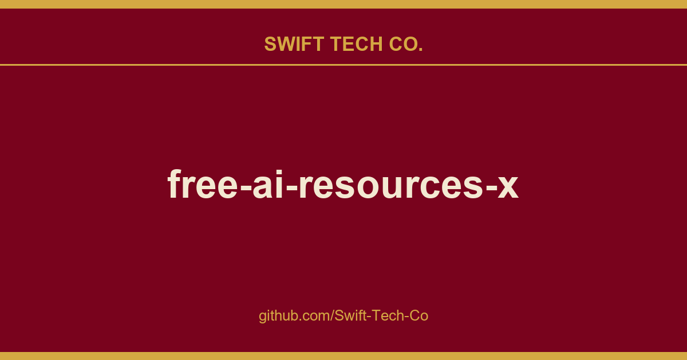

# free-ai-resources-x

## What This Is

Every project needs a shelf of ready answers. product and engineering is one of those shelves, and free-ai-resources-x is the entry on it - the notes, patterns and fixes we reuse when this kind of work comes up.

## Images

## Why This Repository?

Most "awesome lists" are just link dumps. This one is different:

- **Structured for learning**  Resources organized by topic AND difficulty (`Beginner` → `Intermediate` → `Advanced`)
- **Quality over quantity**  Every resource is verified: free, high-quality, and from reputable sources (Stanford, MIT, Google, DeepMind, fast.ai, Hugging Face)
- **Practical paths**  Not sure where to start? Follow our [learning paths](#-pick-your-path) below
- **Always current**  Community maintained and regularly updated

---

## 🎯 Pick Your Path

Not sure where to start? Choose your level:

### 🟢 "I'm brand new to AI"

> **Time: 3-6 months** · No prerequisites needed

| Step | What to Learn | Resource |
|------|--------------|----------|
| 1 | Learn Python basics | [**Python for AI**](resources/python-for-ai.md) |
| 2 | Build math intuition | [**Mathematics for AI**](resources/mathematics-for-ai.md) |
| 3 | Understand ML fundamentals | [**Machine Learning**](resources/machine-learning.md) |
| 4 | Get hands on with frameworks | [**AI Tools & Frameworks**](resources/ai-tools-frameworks.md) |
| 5 | Try your first project | [**Data Science**](resources/data-science.md) |

### 🟡 "I know the basics, want to specialize"

> **Time: 2-4 months per specialization**

| Interest | Path |
|----------|------|
| Build chatbots & AI apps | [Generative AI](resources/generative-ai.md) → [Prompt Engineering](resources/prompt-engineering.md) → [AI Agents](resources/ai-agents.md) |
| Work with text & language | [NLP](resources/nlp.md) → [Generative AI](resources/generative-ai.md) → [AI Research](resources/ai-research.md) |
| Work with images & video | [Computer Vision](resources/computer-vision.md) → [AI Art & Image Gen](resources/ai-art-image-generation.md) → [Multimodal AI](resources/multimodal-ai.md) |
| Deploy models to production | [Deep Learning](resources/deep-learning.md) → [MLOps](resources/mlops.md) → [AI Hardware](resources/ai-hardware.md) |
| Healthcare / Finance | [Deep Learning](resources/deep-learning.md) → [AI in Healthcare](resources/ai-healthcare.md) or [AI in Finance](resources/ai-finance.md) |
| Land an AI job | [Machine Learning](resources/machine-learning.md) → [Deep Learning](resources/deep-learning.md) → [AI Career Prep](resources/ai-career.md) |

### 🔴 "I'm experienced, want cutting-edge topics"

> **Deep dives into advanced research and systems**

| Topic | Resource |
|-------|----------|
| Multi agent systems | [**AI Agents**](resources/ai-agents.md) |
| Graph based learning | [**Graph Neural Networks**](resources/graph-neural-networks.md) |
| Model interpretability | [**Explainable AI**](resources/explainable-ai.md) |
| AI safety & alignment | [**AI Ethics**](resources/ai-ethics.md) + [**AI Security**](resources/ai-security-privacy.md) |
| Frontier research | [**AI Research & Papers**](resources/ai-research.md) |
| Embedded & edge ML | [**Edge AI & IoT**](resources/edge-ai-iot.md) |

---

## 📚 All Categories

### 🏗️ Foundations
*Start here if you're new to AI*

| Category | What You'll Learn | Resources |
|----------|-------------------|-----------|
| [**Python for AI**](resources/python-for-ai.md) | Python programming essentials for ML and data science | 15 |
| [**Mathematics for AI**](resources/mathematics-for-ai.md) | Linear algebra, calculus, probability, and optimization | 14 |
| [**Machine Learning**](resources/machine-learning.md) | Core ML algorithms  regression, classification, clustering | 14 |
| [**Deep Learning**](resources/deep-learning.md) | Neural networks, CNNs, RNNs, Transformers | 15 |
| [**Data Science**](resources/data-science.md) | Data analysis, visualization, and statistical methods | 14 |

### 🧠 Advanced Techniques
*Specialized methodologies for deeper expertise*

| Category | What You'll Learn | Resources |
|----------|-------------------|-----------|
| [**Reinforcement Learning**](resources/reinforcement-learning.md) | RL algorithms, policy learning, game AI | 13 |
| [**Graph Neural Networks**](resources/graph-neural-networks.md) | Graph learning, network analysis, geometric DL | 11 |
| [**Explainable AI (XAI)**](resources/explainable-ai.md) | Model interpretability, transparency, SHAP, LIME | 12 |

### 🌍 Domain Applications
*AI applied to specific industries and fields*

| Category | What You'll Learn | Resources |
|----------|-------------------|-----------|
| [**Computer Vision**](resources/computer-vision.md) | Image processing, object detection, segmentation | 14 |
| [**Natural Language Processing**](resources/nlp.md) | Text analysis, transformers, language models | 14 |
| [**Audio & Speech Processing**](resources/audio-speech.md) | Speech recognition, TTS, audio classification | 13 |
| [**AI in Healthcare**](resources/ai-healthcare.md) | Medical imaging, drug discovery, clinical AI | 13 |
| [**AI in Finance**](resources/ai-finance.md) | Algorithmic trading, risk modeling, financial ML | 13 |
| [**Robotics & Autonomous Systems**](resources/robotics.md) | ROS, robot learning, autonomous vehicles | 14 |

### 🔧 Data & Systems
*Specialized data processing and architectures*

| Category | What You'll Learn | Resources |
|----------|-------------------|-----------|
| [**Time Series & Forecasting**](resources/time-series.md) | Predictive models, ARIMA, Prophet, temporal patterns | 13 |
| [**Recommender Systems**](resources/recommender-systems.md) | Collaborative filtering, content-based, hybrid methods | 13 |
| [**Multimodal AI**](resources/multimodal-ai.md) | Vision-language models, cross-modal learning | 13 |

### ⚙️ Tools & Infrastructure
*Frameworks, deployment, and hardware*

| Category | What You'll Learn | Resources |
|----------|-------------------|-----------|
| [**AI Tools & Frameworks**](resources/ai-tools-frameworks.md) | PyTorch, TensorFlow, Hugging Face, scikit-learn | 15 |
| [**MLOps & Deployment**](resources/mlops.md) | Model serving, pipelines, monitoring, production ML | 14 |
| [**AI Hardware & Infrastructure**](resources/ai-hardware.md) | GPUs, TPUs, distributed training, CUDA | 14 |
| [**Edge AI & IoT**](resources/edge-ai-iot.md) | TinyML, on-device ML, embedded systems | 14 |

### 🔒 Security & Ethics
*Responsible, safe, and secure AI development*

| Category | What You'll Learn | Resources |
|----------|-------------------|-----------|
| [**AI Ethics**](resources/ai-ethics.md) | Bias, fairness, alignment, responsible AI | 14 |
| [**AI Security & Privacy**](resources/ai-security-privacy.md) | Adversarial ML, federated learning, differential privacy | 14 |

### 🚀 Generative AI & Modern Applications
*The latest in AI capabilities*

| Category | What You'll Learn | Resources |
|----------|-------------------|-----------|
| [**Generative AI**](resources/generative-ai.md) | LLMs, text generation, diffusion models | 16 |
| [**Prompt Engineering**](resources/prompt-engineering.md) | Crafting effective prompts, optimization techniques | 13 |
| [**AI Agents**](resources/ai-agents.md) | Autonomous agents, tool use, multi-agent systems | 14 |
| [**AI Art & Image Generation**](resources/ai-art-image-generation.md) | Stable Diffusion, ControlNet, creative AI tools | 14 |
| [**AI for Code Generation**](resources/ai-code-generation.md) | AI coding assistants, pair programming with AI | 13 |

### 💼 Professional Development
*Career skills and staying current*

| Category | What You'll Learn | Resources |
|----------|-------------------|-----------|
| [**AI Research & Papers**](resources/ai-research.md) | Finding, reading, and understanding AI papers | 14 |
| [**AI Career & Interview Prep**](resources/ai-career.md) | Interview prep, portfolio building, job market | 14 |

---

## 🤝 Contributing

This repository grows because of people like you. Here's how to help:

| Action | How |
|--------|-----|
| **Add a resource** | Open a PR adding to the relevant file in `/resources/` |
| **Fix a broken link** | Create an issue or submit a fix directly |
| **Suggest a category** | Open an issue to discuss |
| **Spread the word** | Star the repo and share it with others |

See [CONTRIBUTING.md](CONTRIBUTING.md) for detailed guidelines.

### Quality Standards

Every resource must be:
- ✅ **Free** (or free to audit)  no paywalls
- ✅ **High quality**  from reputable institutions or creators
- ✅ **Accessible**  working links, no broken pages
- ✅ **Educational**  teaches something specific and valuable

---

## 📊 Repository Stats

| Metric | Value |
|--------|-------|
| **Categories** | 30 |
| **Total Resources** | 411+ |
| **Resource Types** | Courses, Books, Tools, Tutorials, Research |
| **Difficulty Levels** | Beginner, Intermediate, Advanced |
| **License** | MIT  use freely |
| **Last Updated** | February 2026 |

---

## ⭐ Support This Project

If this helped you learn, please consider:

- **Fork it**  create your own curated version
- **Contribute**  add resources you've found valuable

---

**[⬆ Back to Top](#free-ai-learning-resources)**

---

*Learning AI should be accessible to everyone, everywhere.*

*Built with ❤️ by the open-source community.*

---

## Swift Tech Co.

Built and maintained by Swift Tech Co.

AI Automation | FinTech Platforms | Custom Software and Mobile Apps | SaaS Platforms | Cloud Infrastructure | Cybersecurity | SEO and Marketing | API Integration

**Join our community on Telegram:** [t.me/+Qt_eFvkb2rliMzNh](https://t.me/+Qt_eFvkb2rliMzNh)

Home | Services | Careers | Referral Program | Influencers | About | Contact

**Connect**

- Website: https://github.com/Swift-Tech-Co/free-ai-resources-x
- LinkedIn: [linkedin.com/in/stephenoladoke](https://www.linkedin.com/in/stephenoladoke/)
- LinkedIn (Company): [linkedin.com/company/swift-tech-co](https://www.linkedin.com/company/swift-tech-co)
- X: [@MrOladoke](https://x.com/MrOladoke)
- Instagram: [@mr.oladoke](https://www.instagram.com/mr.oladoke/)
- Organization: [github.com/Swift-Tech-Co](https://github.com/Swift-Tech-Co)

## Sources

Compiled and maintained from upstream [CelaDaniel/free-ai-resources-x](https://github.com/CelaDaniel/free-ai-resources-x) under permissive open-source license.

---

Maintained by [Swift Tech Co.](https://github.com/Swift-Tech-Co) - [Telegram](https://t.me/+Qt_eFvkb2rliMzNh)

## Sources

Compiled and maintained from upstream [CelaDaniel/free-ai-resources-x](https://github.com/CelaDaniel/free-ai-resources-x) under permissive open-source license.

---

Maintained by [Swift Tech Co.](https://github.com/Swift-Tech-Co) - [Telegram](https://t.me/+Qt_eFvkb2rliMzNh)

## Sources

Compiled and maintained from upstream [CelaDaniel/free-ai-resources-x](https://github.com/CelaDaniel/free-ai-resources-x) under permissive open-source license.

---

Maintained by [Swift Tech Co.](https://github.com/Swift-Tech-Co) - [Telegram](https://t.me/+Qt_eFvkb2rliMzNh)